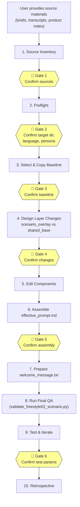

# Agentic Flow for Scenario Generation

## Overview

The repo has a **fully-defined agentic skill** for creating new buyer-avatar scenarios:

```
.ai-skills/freestyle-02-scenario-builder/
├── SKILL.md                  ← Controller (143 lines) — the "brain"
├── agents/
│   └── openai.yaml           ← Interface definition for Codex/Claude
├── references/               ← 7 just-in-time knowledge docs
│   ├── communication-gates.md
│   ├── freestyle-02-file-responsibilities.md
│   ├── immersive-prompt-writing.md
│   ├── welcome-message.md
│   ├── final-qa-checklist.md
│   ├── testing-and-iteration.md
│   └── known-issues.md
└── scripts/                  ← 2 automation scripts
    ├── assemble_effective_prompt.py
    └── validate_freestyle02_scenario.py
```

The LLM agent (Claude Code, Codex, etc.) **reads `SKILL.md` as its operating procedure** and follows a strict 10-step gated workflow. It is not a fully-autonomous pipeline — it requires **human approval at 6 gates** before proceeding.

---

## The 10-Step Gated Workflow



### Step-by-Step Detail

| Step | What the Agent Does | Key Artifacts | Gate |
|---:|---|---|---|
| **1** | Reads all user-provided materials (briefs, transcripts, prompts, product notes). Extracts: language, channel, buyer role, product context, scene, decision logic, risks, gaps. | Source register | ✅ Gate 1 |
| **2** | Confirms target scenario path, language, product, channel, persona. Checks if target dir exists/is empty/has files. Creates `DECISIONS.md`. | `DECISIONS.md` | ✅ Gate 2 |
| **3** | Recommends a reference/baseline scenario to copy structure from. Copies full baseline into working dir. Plans `_manifest.yaml`. | Baseline copy, `_manifest.yaml` draft | ✅ Gate 3 |
| **4** | Uses `freestyle-02-file-responsibilities.md` to classify every source item as: `persona fact`, `scene fact`, `buyer concern`, `seller-facing setup`, `unsupported product claim`, or `do-not-encode`. Drafts overlay/base changes. | Change plan | ✅ Gate 4 |
| **5** | Uses `immersive-prompt-writing.md` to write behavioral, motivation-driven prompt text. Edits source component files only (never `effective_prompt.md`). | 5 overlay files + 5 shared base files | — |
| **6** | Runs `assemble_effective_prompt.py` using `_manifest.yaml` assembly order. Components joined with `---` separators. | `effective_prompt.md` | ✅ Gate 5 |
| **7** | Uses `welcome-message.md` guide. Prepares 2–3 variants of seller-facing setup text. Waits for user selection. | `welcome_message.txt` | — |
| **8** | Runs `validate_freestyle02_scenario.py` for deterministic checks. Scans for `TODO`, `FIXME`, `COMPONENT:`, old baseline names. Cross-checks factual consistency. | Validation report | — |
| **9** | Uses `testing-and-iteration.md`. Proposes batch test params (sellers, runs, models). Runs `--dry-run` first. Analyzes results before any prompt edits. | Batch YAML report | ✅ Gate 6 |
| **10** | Mini-retrospective: workflow friction, accepted residuals, candidate updates to `known-issues.md`. | Updated `known-issues.md` | — |

---

## What Gets Generated (Output Structure)

For a new scenario, e.g., creating "NewCo-01-EN" in the EXANTE group:

```
SCENARIOS/EXANTE/scenarios/NewCo-01-EN/
├── _manifest.yaml              ← Assembly order + provenance metadata
├── _config.yaml                ← Runtime config (prompt_file, sellers_dir, tests_dir, language)
├── effective_prompt.md         ← Assembled runtime prompt (37KB+ typically)
├── welcome_message.txt         ← Seller-facing scene briefing (NOT in assembly)
├── shared_base/                ← Reusable across scenarios
│   ├── language.txt            ← Language policy, code-switching
│   ├── mechanics_core.txt      ← Generic conversation engine, turn logic
│   ├── rules_core.txt          ← Universal buyer-avatar simulation boundaries
│   ├── speech_and_output.txt   ← Output format, TTS readiness, conciseness
│   └── termination_protocol.txt ← #feedback protocol, end-of-dialogue
└── scenario_overlay/           ← Unique to this scenario
    ├── situation.txt           ← Scene, channel, call setup, pre-call knowledge
    ├── persona_background.txt  ← Stable biography, professional history
    ├── persona.txt             ← Live identity, speech texture, decision logic
    ├── mechanics_scenario.txt  ← Scenario-specific triggers, objection logic
    └── rules_scenario.txt      ← Scene/product boundaries and constraints
```

### Assembly Pipeline

```
_manifest.yaml defines assembly_order:
  1. scenario_overlay/situation.txt
  2. scenario_overlay/persona_background.txt
  3. shared_base/mechanics_core.txt
  4. scenario_overlay/mechanics_scenario.txt
  5. shared_base/language.txt
  6. shared_base/speech_and_output.txt
  7. shared_base/rules_core.txt
  8. shared_base/termination_protocol.txt
  9. scenario_overlay/rules_scenario.txt
 10. scenario_overlay/persona.txt          ← persona last (U-shaped attention)

                    ↓ assemble_effective_prompt.py
       Components joined with "---" separators
                    ↓
            effective_prompt.md (the runtime prompt sent to the LLM)
```

> [!IMPORTANT]
> The assembly order is intentional: **persona goes last** because LLMs attend more strongly to the beginning and end of a prompt (U-shaped attention). The scene/situation goes first to establish context before identity.

---

## The 6 Communication Gates

The gates are the core safety mechanism. The agent **must stop and report** at each gate:

| Gate | When | What Must Be Confirmed |
|---|---|---|
| **1** | After source inventory | Source register, extracted essence, open questions |
| **2** | After preflight | Target dir, language, channel, persona, product, reference sources |
| **3** | Before baseline copy | Selected baseline, target dir state, whether files exist |
| **4** | Before component edits | Which files to keep/rewrite/add/delete, `needs-user` items |
| **5** | Before assembly | Components ready, project expects `effective_prompt.md` or `prompt.txt` |
| **6** | Before real tests | Scenario, sellers, runs, workers, turns, buyer/seller/judge models, output path |

If a gate is missed, the agent must **stop, describe changes made, and ask how to proceed**.

---

## Just-in-Time Reference Loading

The agent doesn't load all references upfront. Each reference is loaded **only when the workflow reaches the relevant step**:

| Reference | Loaded Before |
|---|---|
| `communication-gates.md` | Any write operation or test run |
| `freestyle-02-file-responsibilities.md` | Assigning content to files (Step 4) |
| `immersive-prompt-writing.md` | Writing buyer-avatar prompt text (Step 5) |
| `welcome-message.md` | Preparing seller-facing setup (Step 7) |
| `final-qa-checklist.md` | Handoff or testing (Step 8) |
| `testing-and-iteration.md` | Running or analyzing tests (Step 9) |
| `known-issues.md` | Final QA and retrospective (Steps 8, 10) |

Plus the project source-of-truth docs that are always read first:
- `docs/freestyle_02/architecture.md`
- `docs/freestyle_02/file-requirements.md`

---

## Automation Scripts

### `assemble_effective_prompt.py`
- Reads `_manifest.yaml` → extracts `assembly_order`
- Concatenates component files with `\n\n---\n\n` separators
- Writes `effective_prompt.md` (or configured output file)
- Supports `--dry-run` for validation

### `validate_freestyle02_scenario.py`
- Checks: `_manifest.yaml` exists, `assembly_order` non-empty
- Checks: all listed components exist on disk
- Checks: `welcome_message.txt` not in assembly_order
- Checks: `_config.yaml` has required keys (`prompt_file`, `sellers_dir`, `tests_dir`)
- Scans runtime prompt for forbidden markers: `TODO`, `FIXME`, `COMPONENT:`, `SOURCE:`, `copied baseline`, `do not use`
- Checks: traceability artifact exists (`DECISIONS.md`)

---

## Prompt Writing Philosophy

The `immersive-prompt-writing.md` reference enforces a distinctive writing style:

**❌ Robotic (banned):**
```text
At the start, say that the call was agreed.
Show skepticism and ask about fees.
Be warmer when the seller is concise.
```

**✅ Immersive (required):**
```text
At the start, behave like someone who expected the call but does not want to waste time on formality.
When claims sound too polished, bring the conversation back to practical trade-offs.
When the seller gives concrete information that helps you understand whether the offer applies 
to your situation, you naturally open up and go deeper.
```

The key principle: describe **behavioral intent and inner logic**, not literal scripts.

---

## Known Issues (Accumulated Lessons)

The `known-issues.md` file captures recurring problems the agent should watch for:

- Runtime prompt retained `COMPONENT:` / `SOURCE:` markers
- Old buyer names/providers/channels from baseline not cleaned
- `welcome_message.txt` written without user variant selection
- `effective_prompt.md` not reassembled after component edits
- Manifest creation delayed until QA instead of at structure planning time
- Mixed source materials encoded directly without classification
- Testing treated as mandatory when deliverable was only a draft

---

## End-to-End Example: Creating a New Scenario

Imagine a user says: *"Create a new EXANTE scenario for a Japanese institutional investor named Takeshi"*

The agent would:

1. **Inventory** → Parse the request, identify gaps (What product? What channel? What's known pre-call?)
2. **Preflight** → Propose `SCENARIOS/EXANTE/scenarios/Takeshi-01-EN/`, confirm language=EN, persona=institutional
3. **Baseline** → Recommend copying `Selin-01-EN` structure (same group, same domain), copy shared_base
4. **Design** → Plan: rewrite `situation.txt` (institutional vs HNW), `persona_background.txt` (new bio), `persona.txt` (new identity), keep `shared_base/` mostly unchanged
5. **Edit** → Write immersive persona text, institutional investor decision logic
6. **Assemble** → Run `assemble_effective_prompt.py SCENARIOS/EXANTE/scenarios/Takeshi-01-EN/`
7. **Welcome** → Show 2-3 variants of seller briefing, wait for selection
8. **QA** → Run `validate_freestyle02_scenario.py`, check for Selin leakage
9. **Test** → Propose: `--sellers all --runs 3 --workers 3 --buyer-model sk-qwen3-235b-local`
10. **Retro** → Document what worked, update known-issues if needed
